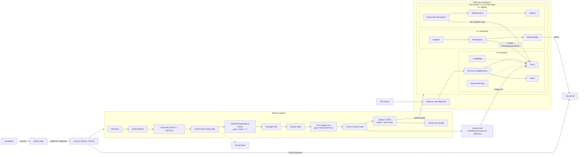
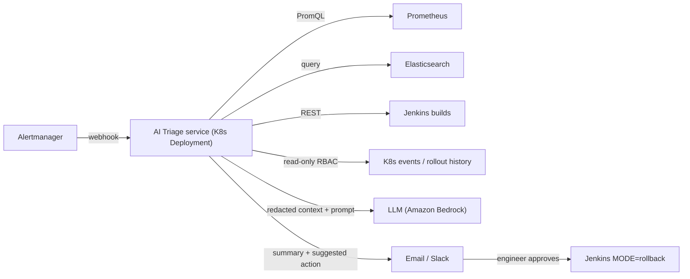

# FinSecure Pay ??Cloud-Native DevOps Pipeline: Design Document

| | |
|---|---|
| **Project** | FinSecure Pay ??Transaction Validation API |
| **Role** | DevOps Engineer |
| **Repository** | `https://github.com/chungyipitt-stack/finsecure-pay` |
| **Target platform** | AWS EKS (ap-southeast-1), Docker Hub, Jenkins |

---

## 1. Purpose and scope

FinSecure Pay is a small fintech startup that needs a fast, repeatable way to ship a transaction validation API with as little manual work as possible. This document describes the solution end to end: source code ??automated quality and security gates ??container image ??managed Kubernetes ??monitoring, alerting and logging ??recovery. It also proposes a practical AI use case for operations.

**Design goals:** (1) every change is built, tested and scanned the same way; (2) nothing insecure or broken reaches production; (3) deployments cause no downtime and can be rolled back in seconds; (4) problems are noticed by alerts before customers report them; (5) no secrets are kept in Git.

---

## 2. End-to-end architecture

**How a request flows:** the client calls the NLB ??Service ??one of two pods. The pod checks the `X-API-Key` header (the key comes from a Kubernetes Secret), applies the validation rules (limits come from the ConfigMap) and returns `200 APPROVED` or `422 REJECTED` with a list of rule violations.

**How a change flows:** `git push` ??Jenkins notices it (polls every 2 minutes) ??11 stages run ??if every gate passes, a new image tagged `1.0.0-<build>-<sha>` is pushed and rolled out to EKS with zero downtime ??a smoke test confirms `/health` reports the new version ??an email is sent.

---

## 3. Major tool choices and justification

| Area | Tool | Why this tool |
|---|---|---|
| Source control | Git + GitHub | Industry standard; Jenkins integration; free public repo works with SonarCloud's free tier. |
| Application | Spring Boot 3.5 / Java 21 / Maven | Recommended stack. Actuator gives probes and Prometheus metrics with no custom code. Maven Wrapper pins the Maven version so builds are reproducible on any machine. |
| Testing | JUnit 5, MockMvc, AssertJ | 49 tests: unit tests for every rule, web-layer tests for status codes, and full-context tests for `/health`, probes and metrics. |
| CI/CD | Jenkins (LTS, in Docker) + declarative Jenkinsfile | Recommended tool. Configuration-as-Code (JCasC) creates the job, admin user and credentials from env vars, so the CI server itself can be rebuilt from code. |
| Registry | Docker Hub | Recommended. Tags are immutable in practice: `<semver>-<build>-<gitsha>` links each image to its commit. `latest` is never used by Kubernetes. |
| Orchestration | AWS EKS (eksctl) | Managed control plane, works with NLB, cluster is defined in `infra/eks-cluster.yaml` and can be recreated or deleted in one command. |
| Code quality | SonarCloud | Hosted SonarQube, so there is no server to run. `sonar.qualitygate.wait=true` makes the gate fail the build without needing an inbound webhook to a laptop. |
| Dependency scan | OWASP Dependency-Check | Checks the Maven dependency tree against NVD. `failBuildOnCVSS=7` blocks HIGH and CRITICAL findings. |
| Image scan | Trivy | Fast scanning of OS packages and the JAR. Blocks fixable HIGH/CRITICAL findings (`--ignore-unfixed`). |
| Secrets | Jenkins Credentials ??Kubernetes Secrets | Secrets live only in Jenkins' encrypted store (loaded from a git-ignored `.env`) and are turned into a Kubernetes Secret at deploy time. |
| Monitoring | kube-prometheus-stack (Prometheus, Grafana, Alertmanager) | One Helm chart provides node, pod, kube-state and application metrics. ServiceMonitor and PrometheusRule are kept in Git with the app. |
| Logging | EFK (Fluent Bit ??Elasticsearch ??Kibana) | Fluent Bit is a lightweight DaemonSet. The app writes Elastic Common Schema (ECS) JSON, so log fields are searchable without extra parsing rules. |
| Notifications | Jenkins Email Extension + Alertmanager email (Gmail SMTP) | Pipeline results and production alerts go to the same ops inbox. |

**Alternatives and why they were not chosen:** GitHub Actions would need no server, but the brief recommends Jenkins. Self-hosted SonarQube needs about 2 GB of RAM and a database, so SonarCloud was chosen. Loki would be lighter than Elasticsearch, but EFK matches the recommended stack.

---

## 4. Key design decisions

1. **The validation rules are configuration, not code.** The amount limits, supported currencies, blocked accounts and allowed clock skew are read from env vars supplied by the ConfigMap, so compliance can change them without a rebuild. Every rule is checked and *all* violations are returned together with stable codes (e.g. `AMOUNT_EXCEEDS_LIMIT`). Clients can fix every problem in one round-trip, and the codes are also used as metric labels.
2. **Business metrics are measured as well as technical ones.** `finsecure_validations_total{result}` and `finsecure_validation_violations_total{code}` let us alert on a jump in rejections (a possible fraud attack or a broken client), which CPU graphs would never show.
3. **Each probe has its own job.** A *startup* probe gives the JVM up to 120 s to start. The *readiness* probe (`/actuator/health/readiness`) controls traffic, and the *liveness* probe (`/actuator/health/liveness`) controls restarts. This stops a slow start from being mistaken for a crash.
4. **Rolling updates have no downtime.** `maxUnavailable: 0, maxSurge: 1`, a 5 s `preStop` sleep so the load balancer can deregister the pod, Spring graceful shutdown, a PodDisruptionBudget (`minAvailable: 1`) and topology spread across nodes.
5. **Image tags can be traced.** `IMAGE_TAG = <pom version>-<BUILD_NUMBER>-<git short sha>` is baked into the image as `APP_VERSION` and returned by `/health`, so it is obvious which build is live during a rollout or rollback.
6. **The pipeline fails fast and runs cheap checks first.** Tests (seconds) run before SonarCloud and dependency scans (minutes), and those run before the image is built or pushed. A failure at any stage stops the pipeline, so **nothing is pushed or deployed**.

---

## 5. Security considerations (DevSecOps)

| Layer | Control |
|---|---|
| Code | SonarCloud quality gate (bugs, vulnerabilities, code smells, coverage on new code). |
| Dependencies | OWASP Dependency-Check, **gate at CVSS ??7**; a suppression file is allowed for confirmed false positives only. |
| Image | Trivy, **gate on fixable HIGH/CRITICAL**; minimal `eclipse-temurin:21-jre-alpine` base with `apk upgrade`; multi-stage build so Maven and the JDK are not in the runtime image. |
| Runtime | Non-root UID 10001, `readOnlyRootFilesystem`, all Linux capabilities dropped, `allowPrivilegeEscalation: false`, seccomp `RuntimeDefault`, CPU and memory limits. |
| API | `X-API-Key` checked with a constant-time comparison; error responses never include stack traces (`include-stacktrace: never`); malformed input returns 400 or 415 JSON responses. |
| Secrets | No secrets in Git (`.gitignore` covers `.env`, `*secret*.yaml`, kubeconfig). Jenkins credentials are bound only inside `withCredentials` blocks and masked in logs. The kubeconfig is created per build and deleted in `post { always }`. The Alertmanager SMTP password and Grafana admin password are stored as Kubernetes Secrets created by the install scripts. |
| Cloud | EKS control-plane audit logging to CloudWatch; OIDC enabled for future IRSA. Grafana is exposed through a LoadBalancer with authentication; Elasticsearch and Kibana are ClusterIP only (reached by port-forward). |

**Security gate demo:** adding `commons-text:1.9` (Text4Shell, CVE-2022-42889, CVSS 9.8) makes the *Dependency Scan* stage fail, and the pipeline stops before *Container Build*. Removing it or upgrading to a fixed version makes the next build pass.

**A real finding during the build:** the first Trivy scan of `finsecure-pay:1.0.0` (Spring Boot 3.5.16) was **blocked** by 6 CRITICAL and 5 HIGH CVEs in libraries the framework pulls in (Tomcat 10.1.55, Jackson 2.21.4, Spring WebMVC 6.2.19). The OS layer had none.
- *Remediated:* overrode the managed versions in `pom.xml` (`tomcat.version=10.1.59`, `jackson-bom.version=2.21.8`), which cleared 9 of the 11 findings.
- *Risk-accepted with governance:* the two Spring WebMVC CVEs are fixed only in Spring Framework 7 (Spring Boot 4). They affect `XsltView` and SSE view rendering, which this JSON-only API does not use. They are listed in `.trivyignore` and in the Dependency-Check suppression file with a justification, an owner and an **auto-expiry of 2026-12-31**, after which the gate blocks again unless the Spring Boot 4 migration is done.
- Reports before and after are kept in `evidence/task5/`.

**Known limitations, accepted for the lab:** Jenkins runs as root to use the Docker Desktop socket; Elasticsearch has security turned off and uses emptyDir storage; the shared API key would be replaced by OAuth2/mTLS in production.

---

## 6. Recovery considerations

| Failure | Detection | Automatic / manual recovery |
|---|---|---|
| Pod crash or deletion | ReplicaSet controller; `FinSecurePayReplicasUnavailable` alert | Kubernetes recreates the pod (shown by deleting a pod; the replacement was Ready in about 30??0 s). |
| App hang or deadlock | Liveness probe fails 3 times | Kubelet restarts the container; `FinSecurePayPodRestarting` alert fires on crash loops. |
| Bad release (never becomes ready) | `kubectl rollout status --timeout=180s` in Jenkins | **Automatic `kubectl rollout undo`**, and the build is marked failed. Old pods keep serving because `maxUnavailable` is 0. |
| Bad release (ready but functionally wrong) | Smoke test, alerts, dashboards | Jenkins `MODE=rollback` (previous revision or a specific `ROLLBACK_TAG`); `revisionHistoryLimit: 10`. |
| Node failure | Node NotReady | Topology spread puts replicas on different nodes; the managed node group replaces the instance. |
| Cluster loss | n/a | The cluster (`eksctl`), workloads (`k8s/`), monitoring and logging are all code, so the whole environment can be rebuilt in about 30 minutes, and images are already in Docker Hub. |

---

## 7. AI use case: AI-assisted incident triage and root-cause analysis

### 7.1 Problem, and why AI fits
When an alert such as `FinSecurePayHighRejectionRate` fires, the on-call engineer has to connect Grafana metrics, Kibana logs, recent Jenkins deployments and Kubernetes events by hand. In a small startup this person may be a developer woken at 3 a.m., so mean time to resolution (MTTR) depends on who happens to be on call. The data is high-volume and unstructured (logs, events, diffs), which suits a large language model (LLM) that can summarise and reason across sources. Classic statistical anomaly detection complements it by spotting deviations *before* fixed thresholds are crossed.

### 7.2 Inputs
- **Metrics (Prometheus API):** rejection ratio, violation codes, p95 latency, 5xx rate, restarts, CPU and memory for a 簣30 min window.
- **Logs (Elasticsearch):** WARN/ERROR lines for `namespace=finsecure`, grouped into patterns (e.g. top violation codes, stack-trace signatures).
- **Change context:** the last 3 Jenkins builds (image tag, commit messages, diff summary, scan results) and the `kubectl rollout history`, ConfigMap diffs and Kubernetes events.
- **Knowledge:** runbooks and past post-mortems (retrieval-augmented generation).
- **Prompt (template):** *"You are an SRE assistant. Given the alert, metrics, log patterns and recent changes, rank the 3 most likely root causes with evidence, state your confidence, and propose safe next steps from the runbook. Do not invent data."*

### 7.3 Expected operational benefits
- An incident summary in the alert email or chat within about 60 s, instead of 15??0 minutes of manual correlation, which targets an MTTR reduction of 30??0%.
- Faster detection of deployment-related regressions, e.g. *"Rejections rose 4 minutes after build #42, which changed `MAX_TRANSACTION_AMOUNT` from 10000 to 1000; suggest rollback to 1.0.0-41-abc123."*
- Anomaly detection on the business metrics finds slow drifts that fixed thresholds miss, with fewer false-positive pages.
- Junior engineers get consistent, runbook-based guidance, and post-mortem drafts are written automatically.

### 7.4 Limitations, risks and governance
- **Hallucination:** the model must cite the metric or log it relies on. Its output is advisory, and a human approves any action.
- **Data privacy (PCI-DSS/PDPA):** logs may contain account numbers. Mask them in Fluent Bit before indexing and send only redacted, aggregated data to the LLM. Prefer a model in the same region or self-hosted (e.g. Amazon Bedrock in ap-southeast-1).
- **Over-automation:** automatic remediation is limited to *reversible* actions (rollback, scale-out) behind an approval step and an audit log.
- **Prompt injection through logs:** treat log content as untrusted data and never as instructions.
- **Cost and drift:** limit token usage, review the quality of suggestions monthly, and keep runbooks up to date.

### 7.5 Integration with this solution

Alertmanager already routes `team=finsecure` alerts. A second `webhook_configs` receiver would call a small triage service running in the cluster. That service uses a read-only ServiceAccount, pulls context from the existing Prometheus, Elasticsearch and Jenkins APIs, calls the LLM and posts the summary. If a rollback is suggested, a link starts the existing Jenkins `MODE=rollback` job, so a human stays in control. In the pipeline, the same approach can summarise failed Trivy or Dependency-Check reports and suggest the minimum safe upgrade.

---

## 8. Lessons learned and future improvements

**Lessons learned**
- Gates are only useful if they *block*. Sonar's `qualitygate.wait`, Dependency-Check's `failBuildOnCVSS` and Trivy's `--exit-code 1` each turn a report into a real gate.
- The order of checks matters for feedback time: running fast checks first (tests before scans) keeps the failed-build loop short.
- The first OWASP Dependency-Check run needs an NVD API key and a cached database, or the pipeline becomes unusably slow.
- Business metrics (rejection ratio) gave more useful alerts than infrastructure metrics alone.
- Putting the version in `/health` made rollout and rollback easy to see during the demo.

**Future improvements**
1. GitOps with Argo CD (pull-based deploys, drift detection) and Argo Rollouts canary releases with automatic analysis on Prometheus metrics.
2. Terraform for the VPC, EKS and IAM; IRSA instead of static AWS keys; Amazon ECR with image signing (Cosign) and an admission policy (Kyverno) that only allows signed images.
3. External Secrets Operator with AWS Secrets Manager or Vault, replacing Jenkins-to-Secret injection.
4. Ephemeral Jenkins agents on Kubernetes with Kaniko or BuildKit (no root Docker socket).
5. Selenium/REST-Assured API tests and OWASP ZAP DAST against a staging namespace before production.
6. HPA on request rate, Elasticsearch with persistent storage and security enabled, and SLO-based (error-budget) alerting.
7. Build the AI triage service from 禮7 as a proof of concept.
